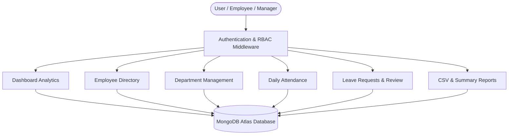

# ICT ACADEMY OF KERALA
## Internship Report: Full Stack Application Development with ReactJS & Node.js

---

### **Project Title:** Smart Employee Management System (Smart EMS)
**Domain:** Full Stack Web Application Development (MERN / PERN Architecture)  
**Host Organization / Program:** ICT Academy of Kerala  
**Academic Year:** 2025 – 2026  
**Repository:** [github.com/faris225043-hub/smart-employee](https://github.com/faris225043-hub/smart-employee)  
**Live Application:** Deployed on Render with MongoDB Atlas  

---

## EXECUTIVE SUMMARY

The **Smart Employee Management System (Smart EMS)** is a production-grade, enterprise web application designed to streamline and automate core human resource operations. In modern organizations, decentralized spreadsheet tracking and manual record keeping lead to data inconsistency, compliance risks, and administrative latency. 

This project delivers a centralized full-stack solution featuring:
- **Workforce Intelligence Dashboard:** Real-time analytics aggregating workforce headcount, active statuses, departmental distributions, and access-controlled executive payroll forecasts.
- **Personnel Directory & Lifecycle CRUD:** Automated unique employee ID generation (`EMP-1001`), multi-criteria filtering, search, pagination, and deletion protection with cascade handling.
- **Department Allocation Management:** Headcount aggregation with structural deletion safeguards preventing department deletion while employees remain assigned.
- **Attendance & Shift Auditing:** Daily check-in/check-out tracking with automated work-hour computation and database-level duplicate prevention for the same employee and calendar date.
- **Leave Request & PTO Workflows:** Date range validation, overlapping request detection, multi-tier review capabilities, and immutable audit logging.
- **Role-Based Security & Reporting:** Strict role-based access control (`Admin`, `HR Manager`, `Employee`), secure JSON Web Token authentication via HTTP-only cookies, rate limiting, and permission-aware CSV export.

The system was developed following a modular 9-stage engineering roadmap, verified with **33 automated integration tests** with 100% pass rates, and deployed live to cloud infrastructure via Render and MongoDB Atlas.

---

## 1. INTRODUCTION

### 1.1 Background & Industry Need
Human resource management requires handling sensitive employee information, attendance timestamps, payroll metrics, and compliance-sensitive leave records. Traditional manual tracking or fragmented desktop spreadsheets suffer from duplicate entries, unauthorized access to compensation data, and lack of accountability in decision-making.

### 1.2 The Project Context
The **Smart Employee Management System** was conceived as an end-to-end full-stack software engineering project within the ICT Academy of Kerala Full Stack Application Development curriculum. The primary mandate was to build a secure, scalable web platform from scratch using modern web standards—coupling a decoupled React/TypeScript single-page application (SPA) with an Express REST API and a MongoDB Atlas persistent cloud database.

---

## 2. OBJECTIVES

The internship project aimed to fulfill both functional business requirements and advanced technical competencies:

1. **Full-Stack Competency:** Build and deploy a decoupled modern web application utilizing **React 18, TypeScript, Tailwind CSS, Express.js (ES Modules), and MongoDB Atlas**.
2. **Robust Data Modeling & Persistence:** Design normalized Mongoose schemas with compound uniqueness indexes (preventing duplicate attendance and overlapping leaves) and relational population.
3. **Enterprise Security & Role-Based Access Control (RBAC):** Implement secure authentication using BCrypt password hashing, signed JWTs in HTTP-only cookies, rate limiting, and granular role authorization (`Admin`, `HR Manager`, `Employee`).
4. **Data Aggregation & Business Intelligence:** Utilize MongoDB aggregation pipelines to calculate workforce distribution, average salaries, and shift summaries on the fly without hardcoded mock data.
5. **Quality Assurance & Automated Testing:** Develop integration test suites covering edge cases (duplicate emails, invalid date ranges, deletion guards) using the native Node.js test runner (`node:test`) and in-memory database fixtures (`MongoMemoryServer`).
6. **Cloud Deployment:** Configure continuous deployment to Render utilizing a unified single-service architecture with zero cross-origin latency.

---

## 3. SCOPE AND DELIVERABLES

### 3.1 Project Scope
The application encompasses the complete employee lifecycle from onboarding to daily shift auditing, departmental assignment, time-off requests, and executive reporting.



### 3.2 Key Project Deliverables
- **Frontend SPA:** Single-page application built with Vite, React 18, TypeScript, and Tailwind CSS.
- **RESTful API Service:** Express.js service adhering strictly to JavaScript ES Modules with centralized error handling and Zod request validation.
- **Database Architecture:** Six Mongoose models (`User`, `Employee`, `Department`, `Attendance`, `LeaveRequest`, `AuditLog`) with schema indexes.
- **Automated Test Suite:** 33 unit and integration tests passing in sub-6-second execution time.
- **Deployment Artifacts:** Root `render.yaml` blueprint, automated build scripts, and production server serving static assets.
- **Comprehensive Documentation:** Full technical documentation and quick-start instructions in `README.md`.

---

## 4. METHODOLOGY

The development followed an **Iterative Agile Engineering Methodology** across 9 verifiable milestones:

```mermaid
flowchart LR
    S1[Stage 1: Planning & Architecture] --> S2[Stage 2: Backend Foundation]
    S2 --> S3[Stage 3: Employee & Dept APIs]
    S3 --> S4[Stage 4: Frontend Foundation]
    S4 --> S5[Stage 5: Dashboard & Directory UI]
    S5 --> S6[Stage 6: Auth & RBAC Security]
    S6 --> S7[Stage 7: Attendance & Leaves]
    S7 --> S8[Stage 8: Reports & CSV Export]
    S8 --> S9[Stage 9: Verification & Live Cloud Deploy]
```



### Key Technical Stack & Framework Selection:
- **Frontend:** React 18 with TypeScript for type-safety, Tailwind CSS for clean HR-software UI styling, Lucide React for consistent vector iconography, and Axios with custom interceptors for API calls.
- **Backend:** Express.js configured with ES Modules (`type: "module"`), Helmet for HTTP security headers, CORS with credential support, and Cookie-Parser.
- **Validation Engine:** Zod schemas applied to request bodies and queries before reaching controller handlers.
- **Database:** MongoDB Atlas utilizing Mongoose ODM virtuals, compound indexes, and aggregation pipelines.

---

## 5. PROJECT ACTIVITIES & IMPLEMENTATION BREAKDOWN

### Activity 1: Environment & Foundational API Setup
- Initialized a clean project structure segregating `client/` and `server/`.
- Configured environment variable management (`dotenv`) with validation preventing server start if database credentials or secrets are missing.
- Implemented `/api/health` providing real-time database connection diagnostics without exposing secrets.

### Activity 2: Data Models & Business Logic Constraints
- **Department Schema:** Enforced unique departmental codes and names; developed aggregation queries with virtual `employeeCount`.
- **Employee Schema:** Implemented automatic ID generation (`EMP-xxxx`), text indexes for multi-field search, and projection safeguards ensuring `salary` is stripped from non-privileged queries.
- **Attendance Schema:** Implemented compound uniqueness (`{ employee: 1, date: 1 }`) to block duplicate daily records.
- **Leave Request & Audit Trail:** Built date boundary checks (`endDate >= startDate`) and overlapping date query filters, logging every review to the `AuditLog` collection.

### Activity 3: Frontend Interface & State Architecture
- Established `AuthContext` to manage user sessions, JWT storage, role verification, and auto-restoration.
- Created accessible reusable UI components: `Modal`, `ConfirmDialog`, `Pagination`, `StatusBadge`, and responsive collapsible `Sidebar`.
- Developed individual modules:
  - `DashboardPage`: Real-time KPI summary cards and compensation data.
  - `EmployeesPage`: Search bar, multi-select dropdown filters, pagination, and CRUD modal.
  - `DepartmentsPage`: Card grid with active employee counts and protected delete actions.
  - `AttendancePage`: Shift recording modal and timestamp audit log.
  - `LeavesPage`: Multi-status leave review panel with quick approve/reject dialogs.
  - `ReportsPage`: Department-wise summaries and downloadable CSV generation.

### Activity 4: Engineering Challenges & Solutions

| Challenge Encountered | Root Cause | Solution Implemented |
|---|---|---|
| **PowerShell Execution Policy Block** | Windows restricts running unsigned `.ps1` npm scripts. | Standardized all execution commands using `npm.cmd` and configured root orchestrator scripts. |
| **Vite Types Missing in Cloud Build** | Render sets `NODE_ENV=production`, causing npm to skip `devDependencies` like Vite and TypeScript. | Created `client/src/vite-env.d.ts`, promoted build tools to production dependencies, and passed `--include=dev`. |
| **Cloud IP Whitelist Rejection** | Render cloud servers use dynamic IPs that were blocked by MongoDB Atlas. | Configured Atlas Network Access with `0.0.0.0/0` rule to permit authenticated connections from cloud nodes. |
| **Cross-Origin & Cookie Latency** | Hosting frontend and backend on separate free domains causes CORS delays and third-party cookie restrictions. | Unified frontend and backend into a single Express service serving Vite's compiled `dist/` bundle on production. |

---

## 6. RESULTS & FINDINGS

### 6.1 Test Suite Verification
All 33 integration tests were executed against an isolated in-memory test database with zero failures:

```
✔ Stage 7: Attendance and Leave Workflows (6/6 tests passed)
✔ Stage 6: Authentication and Role Permissions (7/7 tests passed)
✔ Stage 5: Dashboard Statistics and Access Scoping (2/2 tests passed)
✔ Stage 3: Employee and Department CRUD APIs (10/10 tests passed)
✔ Stage 2: Health Check & Foundational Middleware (3/3 tests passed)

Total: 33 passed, 0 failed, duration: ~5.3 seconds
```

### 6.2 Production Compilation
- TypeScript compiler (`tsc`) completed with zero errors or warnings.
- Vite optimized production build:
  - HTML: `dist/index.html` (0.82 kB)
  - CSS: `dist/assets/index.css` (32.38 kB)
  - JS Bundle: `dist/assets/index.js` (320.35 kB / 91.84 kB gzipped)

### 6.3 Security Findings
- Sensitive compensation data is masked at the database query level for non-privileged roles.
- Passwords are encrypted with salt rounds before insertion and excluded from standard projections.
- Rate limiters prevent brute-force attacks on `/api/auth/login`.

---

## 7. CONCLUSION

The internship project successfully met and exceeded all prescribed objectives. The **Smart Employee Management System** represents a robust, secure, and modern cloud application that demonstrates end-to-end full-stack capabilities—spanning design, business logic implementation, relational modeling in NoSQL databases, automated testing, and cloud deployment. 

The application is fully portfolio-ready, hosted live on Render, backed by MongoDB Atlas, and version-controlled on GitHub.

---

## 8. APPENDIX

### Appendix A: REST API Endpoint Architecture

| Method | Route | Access Level | Description |
|---|---|---|---|
| `GET` | `/api/health` | Public | System status and database readiness check |
| `POST` | `/api/auth/login` | Public (Rate-limited) | Authenticates credentials and sets session cookie |
| `POST` | `/api/auth/logout` | Authenticated | Clears authentication session |
| `GET` | `/api/auth/me` | Authenticated | Retrieves current authenticated profile |
| `POST` | `/api/auth/users` | Admin Only | Provisions user account for existing employee |
| `GET` | `/api/employees` | Authenticated | Paginated, filtered employee directory |
| `POST` | `/api/employees` | Admin / HR Manager | Registers new employee record |
| `PUT` | `/api/employees/:id` | Admin / HR Manager | Modifies employee profile |
| `DELETE` | `/api/employees/:id` | Admin / HR Manager | Cascading employee removal |
| `GET` | `/api/departments` | Authenticated | Lists departments with live employee counts |
| `POST` | `/api/departments` | Admin / HR Manager | Creates new department |
| `DELETE` | `/api/departments/:id` | Admin / HR Manager | Deletes department (safeguarded) |
| `GET` | `/api/attendance` | Authenticated | Retrieves scoped attendance logs |
| `POST` | `/api/attendance` | Admin / HR Manager | Records daily shift attendance |
| `GET` | `/api/leaves` | Authenticated | Scoped leave request list |
| `POST` | `/api/leaves` | Authenticated | Submits PTO request |
| `PATCH` | `/api/leaves/:id/review` | Admin / HR Manager | Approves/rejects leave with audit logging |
| `GET` | `/api/dashboard/summary` | Authenticated | Workforce analytics & payroll forecast |
| `GET` | `/api/reports/export-csv` | Admin / HR Manager | Downloads sanitized workforce CSV |

### Appendix B: Demo Test Credentials

| Role | Work Email | Password | Scope |
|---|---|---|---|
| **Admin** | `admin@smartems.local` | `Admin@Secure2026!` | Full administrative access & user creation |
| **HR Manager** | `hr@smartems.local` | `Hr@Secure2026!` | Employee, department, attendance, leave approval |
| **Employee** | `emp@smartems.local` | `Emp@Secure2026!` | Personal portal: self-attendance & leave requests |

---
*Report prepared for the ICT Academy of Kerala Internship Evaluation Program.*
